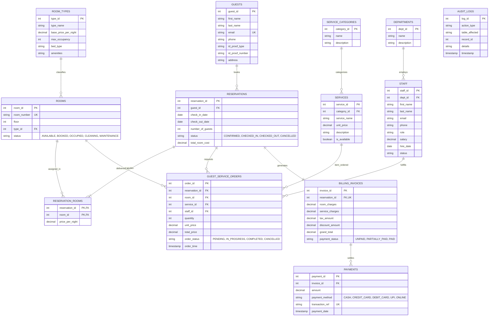

# Hotel Reservation & Guest Services DBMS - Architecture & ER Diagram

## 1. System Overview
The **Hotel Reservation & Guest Services DBMS** is an enterprise-grade relational database application engineered for luxury hospitality operations. It manages the complete guest lifecycle: from initial room selection and booking, guest check-in/out, live room state tracking, specialized concierge & in-room guest services (dining, housekeeping, wellness, transport), through to automated tax calculation, invoice generation, payment processing, and system audit logging.

---

## 2. Entity-Relationship (ER) Diagram

---

## 3. Relational Schema & Normalization (3NF / BCNF)
Every relation in this DBMS conforms to **Third Normal Form (3NF)** and **Boyce-Codd Normal Form (BCNF)**:
1. **1NF**: All table columns are atomic; repeating groups are eliminated.
2. **2NF**: No partial dependencies; in composite tables like `reservation_rooms(reservation_id, room_id)`, attributes depend on the full composite key.
3. **3NF & BCNF**: No transitive dependencies. Room rates are tied to `room_types`, services to `service_categories`, and staff to `departments`. Historical unit prices are locked into transactions to prevent cascading price updates if base prices change later.

---

## 4. Database Procedures, Triggers & Views
- **Triggers**:
  - `trg_calc_service_order_insert` / `trg_calc_service_order_update`: Guarantees `total_price = quantity * unit_price`.
  - `trg_audit_reservation_status`: Real-time system auditing of reservation lifecycle changes.
- **Stored Procedures**:
  - `sp_create_reservation`: Validates room availability and dates, atomicity guarantees.
  - `sp_check_in`: Updates reservation to `CHECKED_IN` and automatically updates room to `OCCUPIED`.
  - `sp_order_guest_service`: Validates active service pricing and registers order.
  - `sp_generate_checkout_bill`: Calculates stay length, aggregates dining/amenities orders, computes 12% hospitality tax and net discount, moves room to `CLEANING`.
  - `sp_record_payment`: Records payment and transitions invoice to `PARTIALLY_PAID` or `PAID`.
- **Views**:
  - `vw_active_guest_stays`: Fast multi-table join for active guests and real-time accrued charges.
  - `vw_room_inventory`: Room matrix with occupant details and cleaning status.
  - `vw_pending_services`: Live order dispatch queue for staff.
  - `vw_financial_summary`: Invoices, revenue, and outstanding receivables.
